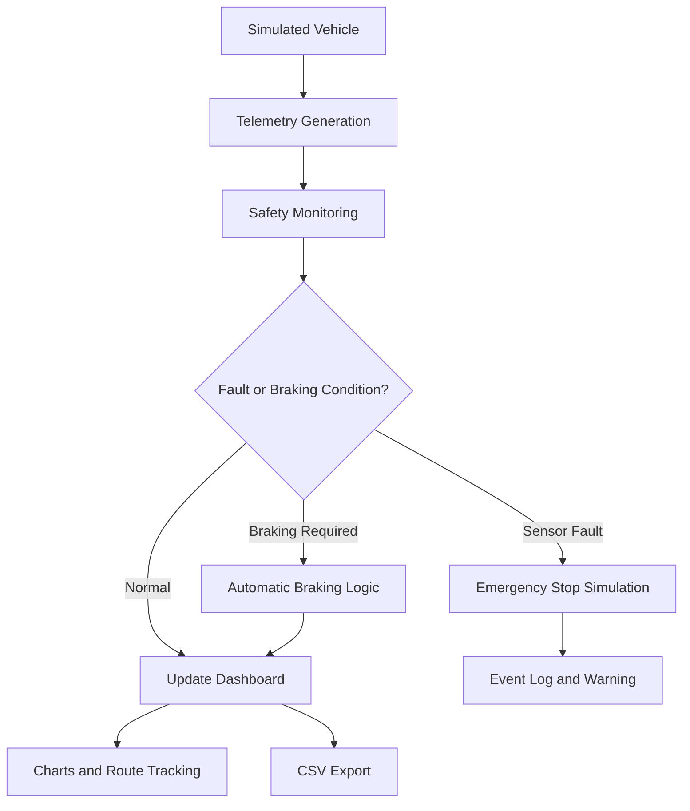

# 🚄 Hyperloop Safety & Tracking Dashboard

A browser-based simulation dashboard designed to demonstrate Hyperloop vehicle monitoring, real-time-style telemetry, route tracking, anomaly detection, and automated braking.

## 📌 Project Overview

The **Hyperloop Safety & Tracking Dashboard** simulates a control interface for monitoring a vehicle travelling through a Hyperloop route. It displays vehicle speed, distance travelled, remaining distance, stopping distance, sensor status, and safety events.

The project demonstrates how telemetry monitoring and rule-based safety logic can help identify abnormal conditions and initiate braking in a simulated transport system.

> **Note:** This is an educational simulation, not a production-ready Hyperloop control or safety system.

## ✨ Features

- **Vehicle Telemetry:** Monitor simulated speed, position, and remaining route distance.
- **Route Tracking:** Visualize vehicle progress along the simulated route.
- **Automatic Braking:** Apply simulated braking based on stopping distance and the configured speed limit.
- **Start, Pause & Reset:** Control the simulation.
- **Sensor Fault Simulation:** Introduce a simulated sensor fault and demonstrate emergency-stop behavior.
- **Anomaly Detection Demonstration:** Inject warning events and monitor them in the dashboard.
- **Sensor Monitoring:** View sensor status and simulated readings.
- **Velocity Chart:** Visualize speed changes during the simulation.
- **Event Logging:** Track warnings, faults, braking events, and other system events.
- **CSV Export:** Export available telemetry data for further analysis.
- **Configurable Settings:** Adjust supported simulation parameters.

## 🎯 Project Objectives

1. Develop an interactive dashboard for simulated Hyperloop monitoring.
2. Demonstrate telemetry collection and visualization.
3. Implement basic stopping-distance-based braking logic.
4. Simulate fault handling and emergency-stop behavior.
5. Record events and export telemetry data for analysis.
6. Understand the role of monitoring and automation in transport safety systems.

## 🛠️ Technologies Used

- **HTML5** — Dashboard structure
- **CSS3** — Styling and responsive layout
- **JavaScript** — Simulation logic, telemetry updates, and dashboard interactions
- **Canvas API** — Velocity chart rendering
- **CSV** — Telemetry data export
- **Git and GitHub** — Version control and project hosting

## 🏗️ System Architecture



## ⚙️ How It Works

1. The simulation generates vehicle movement and telemetry values.
2. The dashboard updates speed, position, and remaining distance.
3. The safety logic evaluates the stopping distance and speed-limit conditions.
4. When braking is required, the simulation applies its braking model.
5. A simulated sensor fault triggers the configured emergency-stop behavior.
6. Events are recorded in the dashboard, and available telemetry can be exported as CSV.

## 🚀 Getting Started

### Prerequisites

- A modern web browser
- Visual Studio Code (recommended)
- Git, if you want to manage the project using version control

### Installation

Clone the repository:

```bash
git clone https://github.com/virajsouner-bot/hyperloop-system.git
```

Open the project folder:

```bash
cd hyperloop-system
```

### Run the Dashboard

If your project uses the standalone version with all CSS and JavaScript included in `index.html`, open `index.html` in your browser.

Alternatively, open the folder in Visual Studio Code and use the **Live Server** extension to launch the dashboard.

If your repository uses a Vite-based version instead, follow that version's package scripts and dependencies.

## 🧪 Testing

The following behaviors can be tested through the dashboard:

- Start and pause the vehicle simulation.
- Resume the simulation and reset it.
- Observe changes in vehicle speed and route position.
- Verify the automatic-braking behavior.
- Inject a simulated anomaly and check the event log.
- Trigger a simulated sensor fault and inspect the emergency-stop response.
- Export telemetry to CSV and inspect the downloaded file.

## 📊 Expected Results

The dashboard provides a visual demonstration of vehicle telemetry, route progress, simulated safety monitoring, braking behavior, fault handling, event logging, and data export.

Results depend on the configured simulation parameters and the test scenario.

## 🔮 Future Enhancements

- Integration with physical sensors or a hardware simulator
- Live telemetry streaming using MQTT
- Historical telemetry storage and playback
- More advanced anomaly detection
- Route maps and configurable station locations
- Authentication and role-based access
- Backend integration and persistent event storage
- Automated testing and performance monitoring

## 🎓 Academic Use

This project is intended for educational demonstration and academic study. Its simulation logic illustrates basic concepts in telemetry, monitoring, fault handling, and automated control. It does not validate the safety of a real Hyperloop vehicle.

## 👩‍💻 Repository

**GitHub:** https://github.com/virajsouner-bot/hyperloop-system

## 📄 License

No license has been specified yet. Add a `LICENSE` file if you intend to distribute the project under an open-source license.
